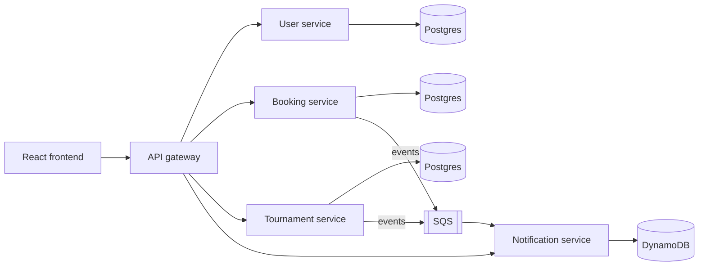

# CourtBook

Court booking and tournaments for the SBU Badminton Club. Members book hourly court slots, join a waitlist when a slot is full, and get the court automatically when someone cancels. Admins run single-elimination tournaments; results update the bracket, the club feed and Elo rankings.

It's built as four Spring Boot services behind an API gateway, with PostgreSQL and DynamoDB, events over SQS, and a React frontend, deployed on AWS.

<!-- TODO: add a screenshot of the booking grid and a 30-second recording:
     a booking race, a cancellation, and the waitlist notification arriving. -->



## Run it locally

You need Docker (Colima works on a Mac).

```bash
docker compose -f deploy/docker-compose.yml up --build
```

Open http://localhost:3000. Register with `admin@courtbook.local` to get an admin account (change the address with `COURTBOOK_ADMIN_EMAILS`), and with any other email for a member account.

To work on one service in IntelliJ instead, start only the infrastructure and run the service's `main` class:

```bash
docker compose -f deploy/docker-compose.yml up postgres elasticmq dynamodb
cd frontend && npm install && npm run dev      # http://localhost:5173, proxies /api to :8080
```

## How double-booking is prevented

The booking table has a partial unique index:

```sql
create unique index bookings_one_active_per_slot on bookings (slot_id) where status = 'ACTIVE';
```

When many requests race for the same slot, Postgres lets exactly one insert commit and rejects the rest; the service turns those into `409 Conflict`. Checking "is it free?" in Java first wouldn't be enough, since two requests can pass that check at the same moment.

[`DoubleBookingRaceTest`](booking-service/src/test/java/com/courtbook/booking/DoubleBookingRaceTest.java) proves it: 100 threads book the same slot at once over HTTP, and exactly one gets `201` while 99 get `409`. CI runs it 10 times in a row on every pull request so a rare timing bug can't slip through on one lucky run. The same check runs against the full Docker setup with k6 in [`load/race.js`](load/race.js).

Cancelling a booking and promoting the next person on the waitlist happen in one transaction, with a version column on the slot so two operations on the same slot can't both commit. More in [docs/architecture.md](docs/architecture.md).

## Tests

```bash
./gradlew build                         # unit + Testcontainers integration tests, including the race test
cd frontend && npm test                 # frontend unit tests
docker compose -f deploy/docker-compose.yml up -d --build --wait
cd e2e && npm ci && npm run journey     # full user journey through the gateway
```

| Layer | What it covers |
|---|---|
| Unit (JUnit) | Bracket generation for 2–32 players, Elo, rate limiter, event → notification text |
| Integration (Testcontainers) | Each service against real Postgres; the notification service against DynamoDB Local and ElasticMQ, including duplicate delivery |
| Race test | 100 simultaneous bookings → exactly 1 succeeds, ×10 |
| End-to-end | Register, book, conflict, waitlist, cancel, notification within 10 s, a 3-player tournament to a champion, feed, stats |
| Contract | The e2e run parses every response with the frontend's own zod schemas, so a renamed field fails CI instead of breaking the page |
| Load (k6) | Booking latency at 50 concurrent users, run locally |

**Load test results** (local, M2 MacBook): _TODO: p50 = __ ms, p99 = __ ms at 50 users_ (`k6 run load/booking-load.js`)

## AWS

| Piece | Service |
|---|---|
| All five containers + Caddy for HTTPS | One EC2 Graviton instance running Docker Compose |
| Users, bookings, tournaments | RDS for PostgreSQL, private, reachable only from the instance |
| Notifications, feed | DynamoDB, on-demand |
| Events | SQS with a dead-letter queue after 5 failed tries |
| Images | GitHub Container Registry |

The instance uses an IAM role that can only touch the one queue and three tables; no AWS keys exist in code or config. Every merge to `main` builds arm64 images and redeploys. Step-by-step setup is in [deploy/aws/README.md](deploy/aws/README.md).

## Docs

- [Architecture and design decisions](docs/architecture.md)
- [Event formats](docs/events.md)
- [Deploying on AWS](deploy/aws/README.md)
- API docs: each service serves Swagger UI at `/swagger-ui.html` on its own port (8081–8084) when run locally.
