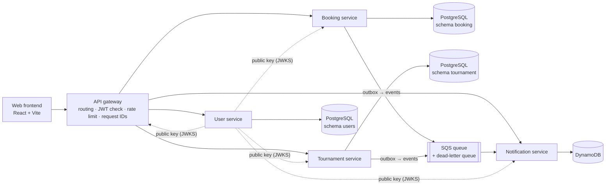

# Architecture



| Service | Port | Owns | Storage |
|---|---|---|---|
| Gateway | 8080 | Routing `/api/**` → `/v1/**`, token checks, CORS, per-IP rate limits, request IDs | none |
| User service | 8081 | Accounts, BCrypt passwords, roles; signs JWTs and publishes its public key | PostgreSQL (`users`) |
| Booking service | 8082 | Courts, slots, bookings, waitlists | PostgreSQL (`booking`) |
| Tournament service | 8083 | Tournaments, sign-ups, brackets, results, Elo ratings | PostgreSQL (`tournament`) |
| Notification service | 8084 | Notifications, the club feed, event de-duplication | DynamoDB |

Locally the three PostgreSQL schemas live in one Postgres container; on AWS they share one RDS instance. No service reads another service's schema. They only share the server to save money.

Each service serves its OpenAPI spec at `/v3/api-docs` and Swagger UI at `/swagger-ui.html` on its own port (not through the gateway).

## Design decisions

### Double-booking is impossible at the database level

```sql
create unique index bookings_one_active_per_slot on bookings (slot_id) where status = 'ACTIVE';
```

When 100 requests race for one slot, each one's `INSERT` reaches Postgres. The first commits; every other insert hits the index and fails. The service turns that into `409 Conflict`. A check in Java ("is the slot free?") can't do this on its own, because two requests can both pass the check before either inserts. The `DoubleBookingRaceTest` fires 100 simultaneous HTTP requests and asserts exactly one `201` and ninety-nine `409`s, and CI runs it 10 times on every pull request.

### Waitlist promotion happens in one transaction

Cancelling and promoting the next member commit together, so there's never a moment where the slot is free while people are waiting. Two version columns stop races around it:

- `slots.version` is bumped (JPA `OPTIMISTIC_FORCE_INCREMENT`) by every operation that changes who's next in line: cancel, join waitlist, leave waitlist. If two of these hit the same slot at once, the second fails its version check at commit and gets a 409 instead of, say, joining a line that's just been emptied.
- `bookings.version` makes a double-clicked cancel fail on the second click rather than running the promotion twice.

### Events through an outbox, not direct calls

If the notification service is down, bookings still work; events wait in the queue. Writing events to an outbox table inside the booking transaction (instead of sending to SQS directly) means an event is published if and only if the change committed.

### Consumers handle duplicates

SQS can deliver a message more than once, and the outbox relay can resend after a crash. The notification service writes each event's ID with a conditional put in the same DynamoDB transaction as the notifications, so a duplicate changes nothing.

### PostgreSQL and DynamoDB, each where it fits

Bookings and tournaments are relational and need constraints and transactions across rows, so they're in Postgres. Notifications and the feed are append-only, always read by one key ("this user's newest 30", "the club's newest 30") and never joined, which is the access pattern DynamoDB is built for. The sort key starts with a fixed-width timestamp, so one `Query` returns them newest first.

### One login, checked everywhere

The user service signs RS256 JWTs with a private key only it holds and publishes the public key at `/.well-known/jwks.json`. The gateway rejects bad tokens before routing; each service validates the token again instead of trusting the network.

### Same code locally and on AWS

ElasticMQ (SQS-compatible) and DynamoDB Local run in Docker Compose. The AWS SDK code is identical in both places; only the endpoint URLs change. On EC2 the endpoints are blank and credentials come from the instance's IAM role.

### What it costs to be microservices

Five JVMs instead of one, about 2–3 GB of RAM in total. Duplicated plumbing (security config, error handling) in each service. A booking that should produce a notification now crosses a queue, so "did the notification arrive?" is eventually consistent (it usually takes under a second). For a club app a single Spring Boot service would honestly be enough; this layout exists to practise the patterns and is documented as such.

## Following a request

The gateway gives every request an `X-Request-Id`, passes it to the service, which logs it on every line (`[%X{requestId}]`) and copies it into any event it publishes. The notification service logs it again when handling the event.

```bash
docker compose -f deploy/docker-compose.yml logs | grep 1b9e4c2a-...
```
